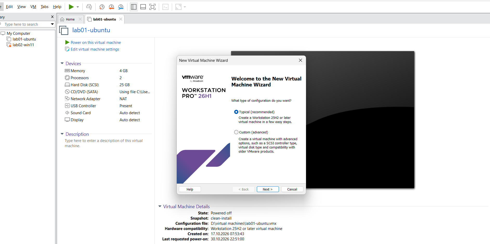
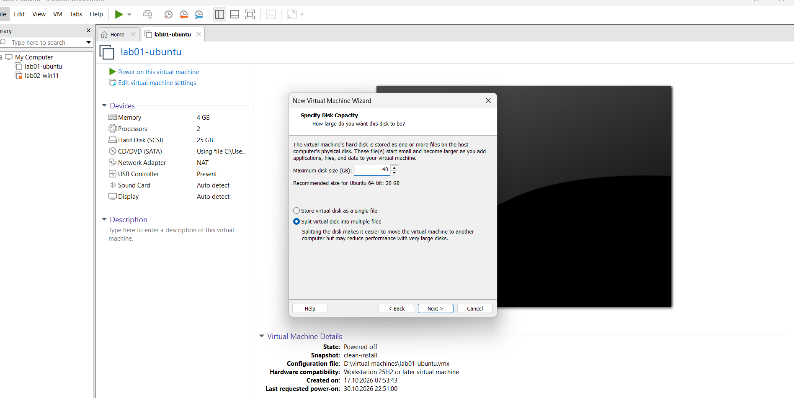
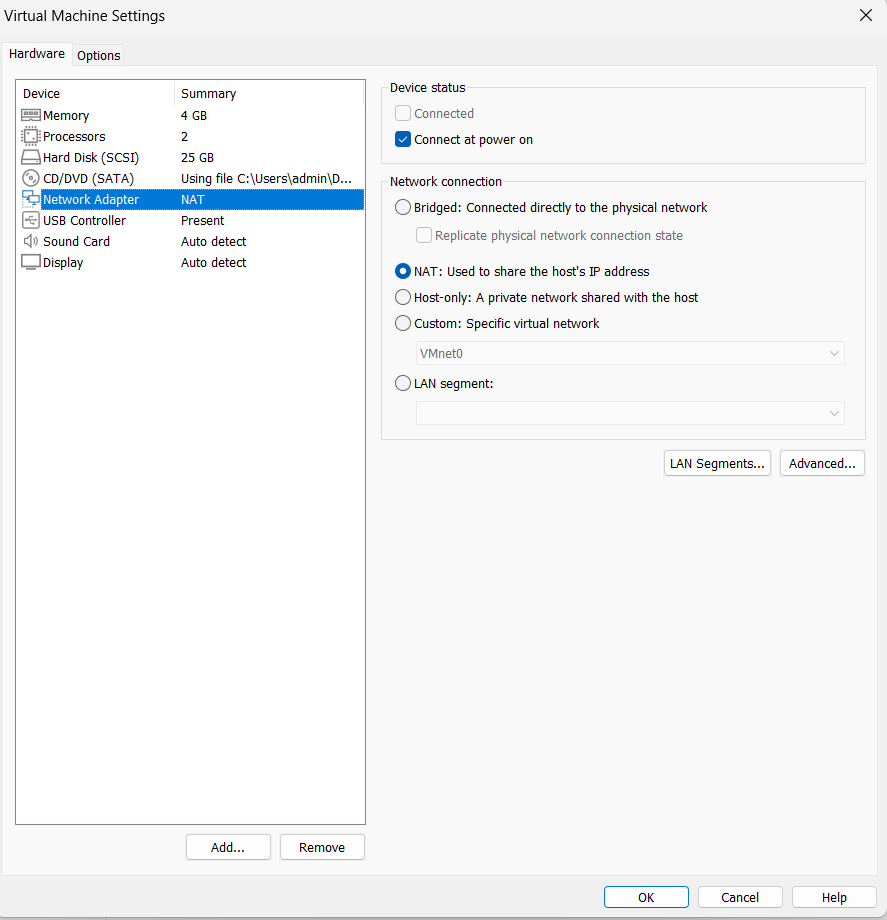
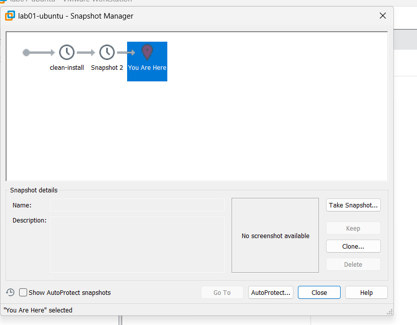

## Build Document: How to set up a test VM

This document explains how to set up the Ubuntu and Windows test VMs from scratch using VMware Workstation.

## Step 1: Creating the Virtual Machine

Open VMware Workstation and click "Create a New Virtual Machine".

*Why this option?* We use the standard installation wizard so we can set specific hardware limits manually, rather than letting VMware guess.

## Step 2: Disk Settings

Set the virtual disk size to 40GB for the Linux VM.

*Why 40GB?* My host machine has a 512GB SSD. Allocating 40GB for the Linux VM and 50GB for the Windows VM leaves enough space on the host for my actual operating system. 

## Step 3: Networking

In the VM settings, under Network Adapter, choose *NAT*.

*Why NAT and not Bridged?* Bridged mode gives the VM its own IP on the physical network, which might cause conflicts with the university network. NAT allows the guest to use the host's IP to access the internet safely without the network filtering it out.

## Step 4: Verifying the System

After installation, I checked the system details inside the guest to verify it was running correctly.

*Evidence:* evidence/04-guest-uname.txt shows the Linux kernel version and architecture.

## Step 5: Testing the Network

I verified that both virtual machines can reach the internet and communicate with each other.

*Why this is important:* A developer needs network access to download packages and test client-server apps.

*Evidence:* evidence/05-ping-between-guests.txt shows a successful ping test with 0% packet loss between the two VMs.

## Step 6: Taking a Snapshot

Finally, I took a snapshot of the clean installation.

*Why this is important:* If the new developer breaks the OS while testing, we can instantly revert to this clean state using the snapshot, which saves hours of reinstallation time.

